I build AI automation, agents, and LLM pipelines that keep working when models, APIs, and data misbehave. Most of my work sits where AI meets backend and cloud engineering: n8n workflows, Python services, PostgreSQL state, and AWS. QA is the thread through all of it. I test the systems I build the way I test other people's: at the boundaries, at the API, and on the failure paths.

 

Also: 34% monthly AWS cost reduction (Lambda, RDS PostgreSQL, API Gateway). Full archive at <a href="https://hiraahmed.me/case-studies/">hiraahmed.me</a>

**Sentinel-Mesh** remediates Terraform cloud-security misconfigurations. An LLM proposes a patch, a Z3 SMT verifier checks it against explicit security invariants, and a rejected patch's counterexample goes back to the model for another attempt. **The model only proposes. The verifier decides.**

- **No security regressions observed** against the modeled invariants (0.0%, 95% interval 0.00% to 3.45%).
- **Scope:** formal guarantees hold only within the Cloud Perimeter Model. Properties outside it (WAF associations, logging policies) are checked without a proof certificate, and an external set of 12 cases reached 6/12.
- Lead author. Preprint on Research Square, manuscript under review. Peer reviewer for IEEE Access (5 verified reviews).

[Preprint](https://www.researchsquare.com/article/rs-10674271/latest) · [CloudFix-Bench on Zenodo](https://doi.org/10.5281/zenodo.20975067) · [Code](https://github.com/hira299/sentinel-mesh) · [Medium article](https://medium.com/@hira299/beyond-heuristics-formally-verifying-ai-generated-infrastructure-with-z3-smt-solvers-e95fd3a7bf95) · [Web of Science](https://www.webofscience.com/wos/author/record/QIV-1552-2026) · [ORCID](https://orcid.org/0009-0005-3219-7252)

Python · FastAPI · PostgreSQL · n8n · LangGraph · LangChain · Groq · Gemini · AWS (EC2, Lambda, EventBridge, SQS, RDS, S3) · Terraform · Docker · Supabase

| Project | What it shows |
|---|---|
| [AI-Autonomous-Email-Agent](https://github.com/hira299/AI-Autonomous-Email-Agent) | Stateful n8n email agent with per-thread memory and Groq inference |
| [Cloud-Security-Audit-Compliance-Automation-Platform](https://github.com/hira299/Cloud-Security-Audit-Compliance-Automation-Platform) | AWS audit pipeline with a persistent audit trail and a DLQ replay workflow |
| [Financial-Profitability-Guardrail](https://github.com/hira299/Financial-Profitability-Guardrail) | PostgreSQL state machine that alerts only on state transitions |
| [Autonomous-Competitor-Intelligence-SEO-Pipeline](https://github.com/hira299/Autonomous-Competitor-Intelligence-SEO-Pipeline) | Scheduled AI pipeline with defensive JSON parsing and a scraper DLQ |
| [Cloud-Cost-Sentinel](https://github.com/hira299/Cloud-Cost-Sentinel) | AWS cost anomaly detection with a rolling baseline |
| [vektor-ats-diagnostics](https://github.com/hira299/vektor-ats-diagnostics) | Multimodal document parsing and weighted evaluation engine |
| [browser-forensics-reconstruction](https://github.com/hira299/browser-forensics-reconstruction) | DFIR tool that reconstructs browser session timelines |
| [aegis-realtime-voice-dispatch](https://github.com/hira299/aegis-realtime-voice-dispatch) | Real-time voice command dispatch dashboard |

**Open resources:** [n8n-production-resilience-patterns](https://github.com/hira299/n8n-production-resilience-patterns) (retries, DLQs, idempotency, replay) · [enterprise-multitenant-qa-matrix](https://github.com/hira299/enterprise-multitenant-qa-matrix) (isolation, RBAC, API and business-logic test matrices)

Remote · 7:00 PM to 3:00 AM PKT, overlapping US/Canada hours and UK, Ireland, Germany afternoons · <a href="https://www.fiverr.com/hira299">Fiverr</a> · <a href="https://www.upwork.com/freelancers/~0178616a4e00b82166">Upwork</a> · <a href="https://topmate.io/hira_ahmed">Topmate</a> · <a href="https://www.researchgate.net/profile/Hira-Ahmed-28">ResearchGate</a>

